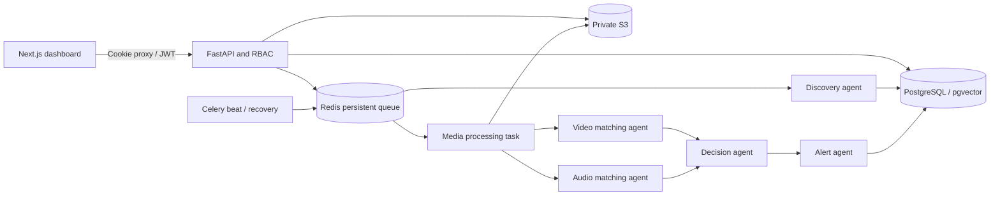

# SceneGuard AI: detection-only MVP

## Scope and trust boundaries

SceneGuard accepts rights-holder reference footage and authorized candidate uploads. No scraper, Instagram downloader, reporting bot, enforcement agent, or takedown endpoint exists. The system cannot identify an arbitrary film without its indexed reference. Synthetic fixture posts use `example.invalid` and are labeled `mock` in evidence.

The browser talks only to Next.js. A server-side proxy keeps the short-lived JWT in a SameSite Strict, HttpOnly cookie. Mutations require an exact allowed Origin. FastAPI independently verifies the JWT and looks up the current user role. Admins manage settings and users; analysts manage footage and acknowledge alerts; viewers see metadata. Only analysts/admins can download private evidence. Secrets remain server-side environment configuration. No browser credential editor or API key readback exists.

PostgreSQL stores users, movies, job states, source metadata/checkpoints, decisions, and in-app alert records. Reference/candidate bytes, thumbnails, and feature artifacts stay in credential-protected S3-compatible storage. The default Compose deployment uses SeaweedFS; databases, Redis and S3 have no public ports. The development override can expose infrastructure only on loopback, subject to Docker network support. Movie feature thumbnails are as sensitive as source footage.

## Phase status

| Phase | Working implementation | Mocked, optional, or restricted | External prerequisites |
|---|---|---|---|
| 1. Architecture | Explicit trust boundaries, roles, storage and pipeline | MVP, no production SLO certification | None |
| 2. Services | Next.js, FastAPI, PostgreSQL/pgvector, Redis, Celery, S3-compatible Compose services | Single-host deployment | Docker with Compose |
| 3. Reference indexing | Validated uploads; bounded FFmpeg decode; keyframes, ORB, pHash, landmarks; indexing status | Synthetic footage supplied as generator | Rights to uploaded reference/candidate footage |
| 4. Matching | ORB ratio test + RANSAC homography and spatial coverage; pHash support; temporal votes; spectral landmark offsets | Optional 512-D CLIP feature ranking; disabled by default | Optional weights and additional dependencies |
| 5. Orchestration | Durable DB pending state, late ACKs, retries, locks, recovery sweeps, terminal error states | Five agent classes share a Celery worker pool | Persistent service volumes |
| 6. Discovery | Official YouTube Search API adapter, checkpoints, deduplication, cadence, retry; distinct platform adapters | Instagram/Facebook unsupported. Mock adapter emits only supplied fixtures. YouTube is metadata-only | YouTube Data API v3 key and query/channel scope; quota; authorized media supplied separately |
| 7. Decisions | Deterministic evidence rules; approved promo exclusion; configurable spoiler boundary | Laya verified with pinned SDK/model and deployed private CPU service; see LAYA.md. Optional HTTPS multimodal advisory contract; live provider unverified | Explicit approval to send unreleased frame thumbnails, endpoint/model/key |
| 8. Dashboard/alerts | Five sections; reference uploads, searches, evidence, settings, queue/coverage states, unique in-app alerts | No external notification delivery | Admin login; optional additional users |
| 9. Tests/deployment | Unit/media, real-service integration, browser E2E, soak tooling, Compose | No claim of complete platform coverage or theatre-wide accuracy | Authorized evaluation corpus for deployment calibration |

## Matching and score semantics

Every sampled reference frame stores pHashes for the full frame and central crops, ORB keypoints/descriptors, and a protected thumbnail. Candidate and reference ORB descriptors undergo a ratio test and RANSAC homography. Matches need at least eight inliers and broad spatial coverage to reject incidental logos or subtitles. Offset votes align multiple candidate frames to the same reference interval. A single frame cannot confirm a match.

Audio is decoded to 11,025 Hz mono and pre-emphasized. An adaptive median/deviation noise floor rejects broadband noise before local spectral peaks are paired into time-quantized fingerprints; time-offset voting estimates matching reference time. Repetitive landmarks are bounded. Audio strengthens a visual decision only with temporal agreement. Missing audio remains valid visual-only input. Candidate audio is not sent to an external model.

`confidence` is an **uncalibrated evidence similarity score**, not a probability. No score is generated by the sample manifest. All scores are computed from decoded footage. The deterministic fallback confirms only thresholded visual evidence or aligned multimodal evidence. Ambiguous evidence remains `review`. Optional vision review can reject or annotate an ambiguous match, never elevate it to confirmed. Promotional material is excluded only after it independently matches an indexed approved promotional reference.

Severity is an operator-defined policy: `high` when the aligned scene is at/after the movie's configured spoiler boundary, `low` before it, `unknown` for unconfirmed decisions. It is not a semantic prediction of plot importance. Full-movie time is relative to the uploaded reference; segment origin offsets are not supported yet.

## Embeddings and Laya

CLIP integration uses Transformers' documented `CLIPProcessor` / `CLIPModel.get_image_features` contract. Optional dependency versions are in `backend/requirements-ai.txt`; model loading requires safetensors and a 512-dimensional projection. Set `CLIP_MODEL=openai/clip-vit-base-patch32` consistently for indexing and matching only after installing dependencies and obtaining weights. Normalized embeddings are stored in pgvector with a cosine HNSW index, and used to rank frames before geometric verification. The default tested pipeline does not download weights. Changing encoders requires reindexing; vectors from different models must not be mixed.

The verified model is `convaiinnovations/laya`; its official SDK is pinned and live CPU inference is deployed behind an internal authenticated service. It reviews structured evidence only. Its output is uncalibrated for this domain and cannot promote weak evidence or establish a match without candidate footage. See [current Laya documentation](LAYA.md).

## Durability and delivery guarantees

The API commits media as `pending` before enqueueing. If Redis publication fails, the periodic DB recovery scan republishes. Celery uses late ACKs and worker-loss rejection, prefetch one, exponential task retries, and a persistent Redis AOF with `noeviction`. Redis media leases prevent parallel processing, DB unique constraints prevent duplicate content identities, detections, and alerts. A crash may delay processing until the lease expires / 35-minute stale sweep; this is eventual recovery, not exactly-once task execution. The transaction stores a detection, its unique in-app alert, and terminal job state together. No SMTP/webhook side effects require delivery coordination.

Run exactly one beat instance. Up to eight processing attempts are allowed; exhausted jobs become visible failures and can be retried by an analyst. Candidates without usable references wait, rather than becoming false negatives. Long media decoding is bounded to two hours and 500 MiB by default, with two FFmpeg threads and 30-minute worker task limits. The baseline geometric matcher scans the reference library; large deployments need benchmarked sharding and candidate retrieval. Do not interpret a two-hour acceptance limit as a throughput guarantee.

YouTube cadence is capped to one search request per ten minutes across workers. The checkpoint includes pagination and an overlap watermark; inserts and checkpoint advancement share a transaction. Retries retain checkpoints. Search results are partial and quota-limited; “metadata discovered” never means its bytes were processed. No API key is logged in HTTP error URLs.

## Operational limitations

The Compose topology is production-oriented, but production requires an infrastructure/security review, HTTPS ingress, `SECURE_COOKIE=true`, an exact `APP_ORIGIN`, managed secrets, encrypted block/object volumes (or private SSE-KMS S3), backups/restore drills, patched and digest-pinned images, capacity and false-positive benchmarks, monitoring alerts, and a real authorized evaluation corpus. Default single-node storage is not HA and does not itself encrypt host disks. Do not place unreleased production footage on unencrypted development volumes.

API readiness checks PostgreSQL, Redis, and object storage; it does not establish worker progress. Agent timestamps report observed work, not process liveness; inspect the scheduler heartbeat, queue depth, and Celery worker ping as well. `/metrics` is admin-authenticated and exports HTTP counters/latency. JSON application events omit secrets; lower-level Celery/FFmpeg logs are not a full audit system. The ten-minute soak observes deployment health and queued synthetic jobs, not real Instagram coverage or 24/7 reliability.

Fingerprint format v2 uses adaptive noise rejection and quantized landmark time differences. Older audio features are explicitly marked incompatible instead of silently compared; reindex them to restore audio support. The geometric matcher remains compatible.

Laya update: verified weights and live private-service inference are deployed; see [Laya integration status](LAYA.md) and [repair validation](REPAIR_REPORT.md). The latest limited public Instagram browser result is documented in [the one-minute scan report](INSTAGRAM-MINUTE.md). These updates supersede earlier statements that the model identity was unknown.
